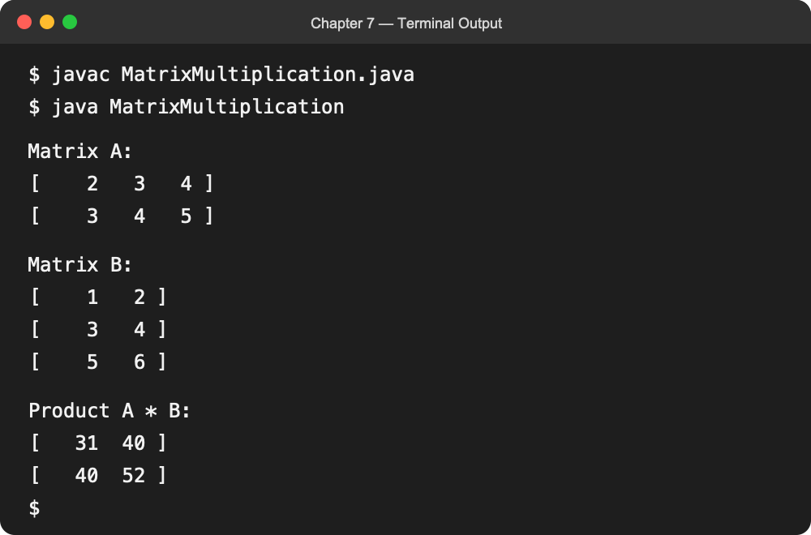

# INFO 5100 Homework — Chapter 7: Loops

This program checks whether two matrices can be multiplied and, when valid, calculates their product with three nested loops. The methods support rectangular matrices of different valid sizes.

## Compile and run

```bash
javac MatrixMultiplication.java
java MatrixMultiplication
```

## Result


